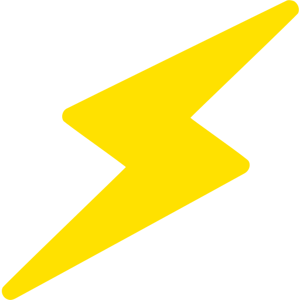

# EnergyControl

  
  
<b>Organize o consumo de energia do seu negócio de forma rápida e inteligente.</b>

 

## 📋 Sobre o Projeto

O **EnergyControl** é uma aplicação web  desenvolvida como projeto prático para a disciplina de **UPX-2** do 2º semestre do curso de **Análise e Desenvolvimento de Sistemas** no **Centro Universitário FACENS**. 

O objetivo da solução é auxiliar o pequeno empreendedor que não possui experiência prévia a gerenciar e monitorar de forma simplificada o controle de seus gastos energéticos mensais.

---

## 🚀 Funcionalidades

* **Monitoramento Eficiente:** Acompanhamento prático do consumo de energia do negócio.
* **Análise de Períodos:** Ferramentas para comparar gastos entre diferentes intervalos de tempo.
* **Foco em Economia:** Dicas e controle inteligente para redução de custos no fim do mês.

---

## 🛠️ Tecnologias Utilizadas

Este projeto foi construído utilizando as seguintes tecnologias web fundamentais:

* **HTML5:** Estruturação semântica das seções da página.
* **CSS3:** Estilização avançada.
* **Google Fonts (Inter):** Tipografia padrão da interface.
* **Figma:** Ferramenta utilizada para a prototipagem e design prévio do layout.

---
